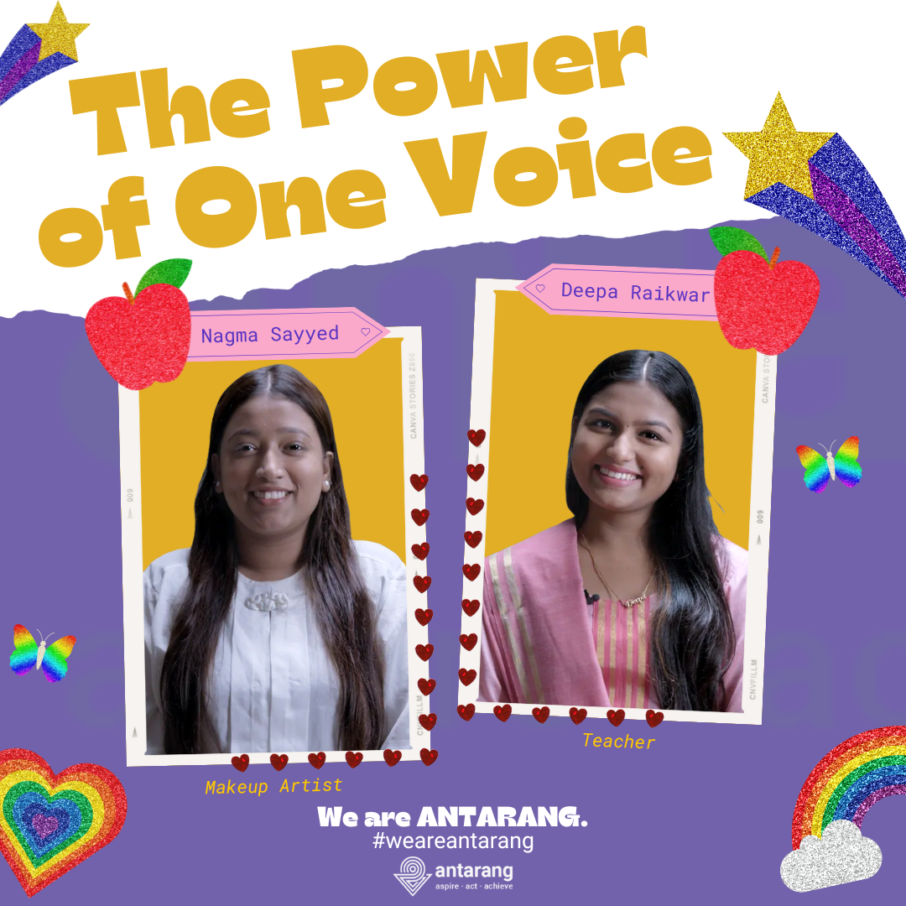
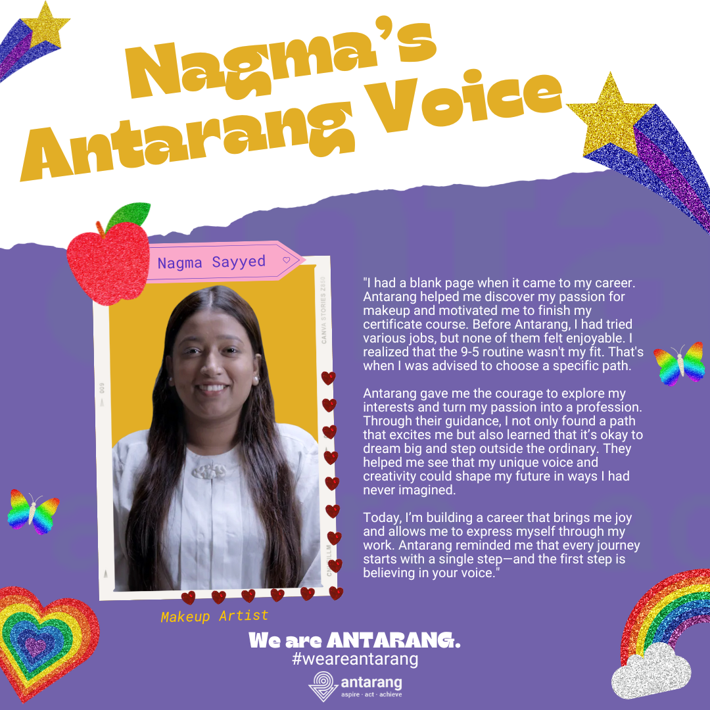
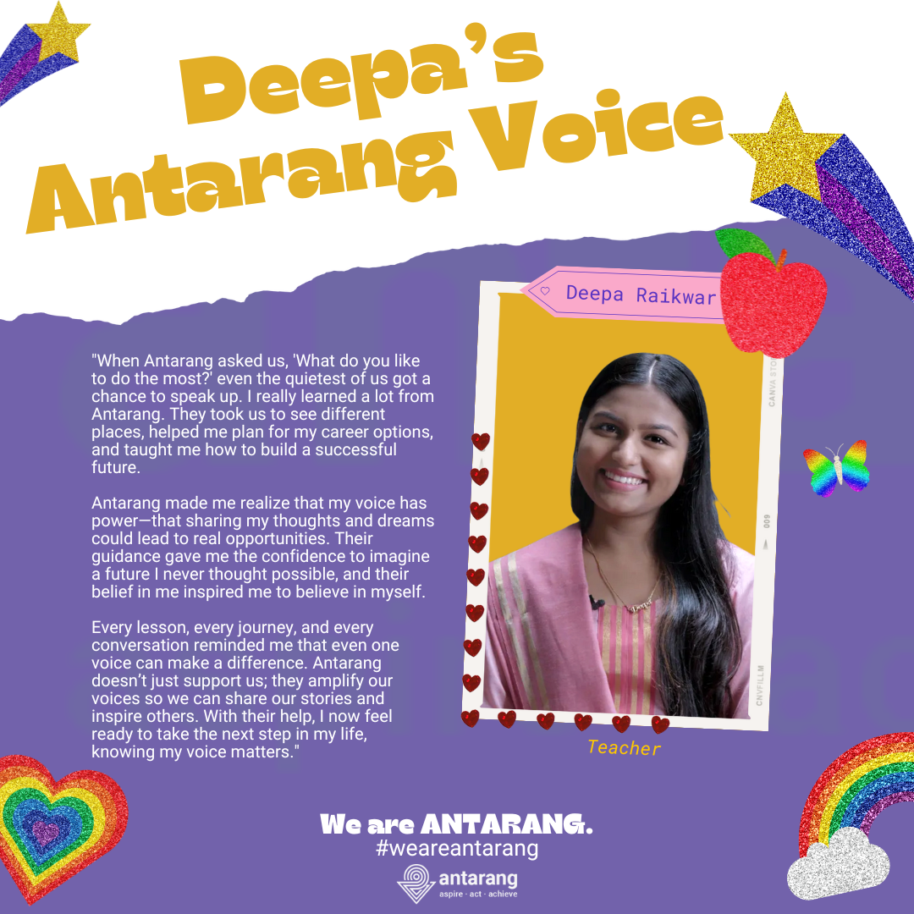

  <h1>⚡ The Power of One Voice</h1>

  

    An Instagram series raising awareness of
    Antarang Foundation's mission and career
    opportunities for young adults in India.
  

<h2>📑 Table of Contents</h2>

<ul>
  <li><a href="#objective">Objective</a></li>
  <li><a href="#project-details">Project Details</a></li>
  <li><a href="#instagram">Instagram</a></li>
  <li><a href="#images">Images</a></li>
</ul>

<h2 id="objective">🎯 Objective</h2>

  This project aims to strengthen Antarang Foundation's
  communications by producing engaging social media content
  that increases awareness, attracts donor support, and
  promotes career opportunities for young adults in India.

<h2 id="project-details">🛠️ Project Details</h2>

  <strong>Tools:</strong> Canva

<h2 id="instagram">📸 Instagram</h2>

  <a href="https://github.com/redefiningvicky/The-Power-of-One-Voice/blob/main/4_Instagram/Instagram_Post_1.png">
    View Post 1
  </a>
  &nbsp; • &nbsp;
  <a href="https://github.com/redefiningvicky/The-Power-of-One-Voice/blob/main/4_Instagram/Instagram_Post_2.png">
    View Post 2
  </a>
  &nbsp; • &nbsp;
  <a href="https://github.com/redefiningvicky/The-Power-of-One-Voice/blob/main/4_Instagram/Instagram_Post_3.png">
    View Post 3
  </a>
  &nbsp; • &nbsp;
  <a href="https://github.com/redefiningvicky/The-Power-of-One-Voice/blob/main/4_Instagram/Instagram_Post_RGB.pdf">
    View PDF
  </a>

<h2 id="images">🖼️ Images</h2>

<h3>Instagram Post 1</h3>

<table>
  <tr>
    <td>
      
    </td>
  </tr>
</table>

<h3>Instagram Post 2</h3>

<table>
  <tr>
    <td>
      
    </td>
  </tr>
</table>

<h3>Instagram Post 3</h3>

<table>
  <tr>
    <td>
      
    </td>
  </tr>
</table>

  

    <a href="https://github.com/redefiningvicky/Creative-Projects">
      Back to Creative Projects
    </a>
    &nbsp; • &nbsp;
    <a href="https://github.com/redefiningvicky/redefiningvicky">
      Back to Portfolio
    </a>
  

